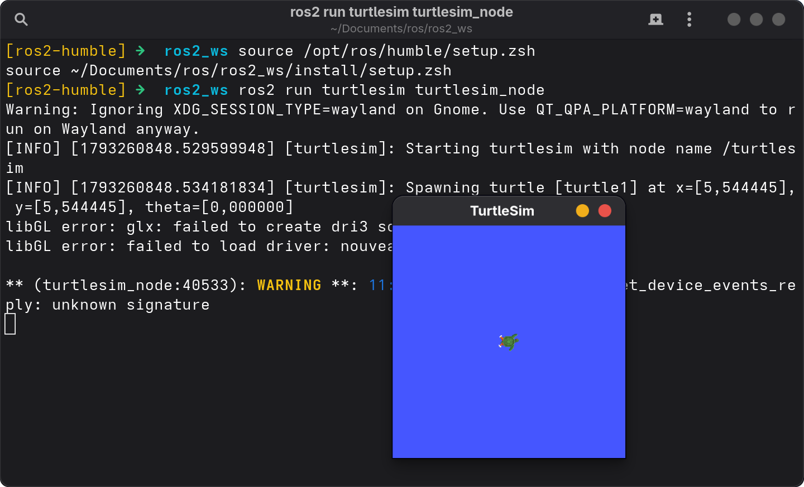
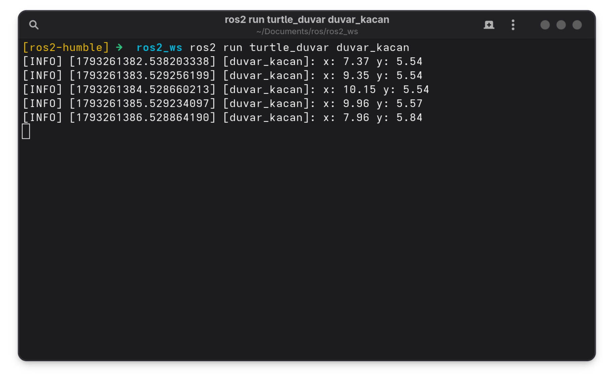
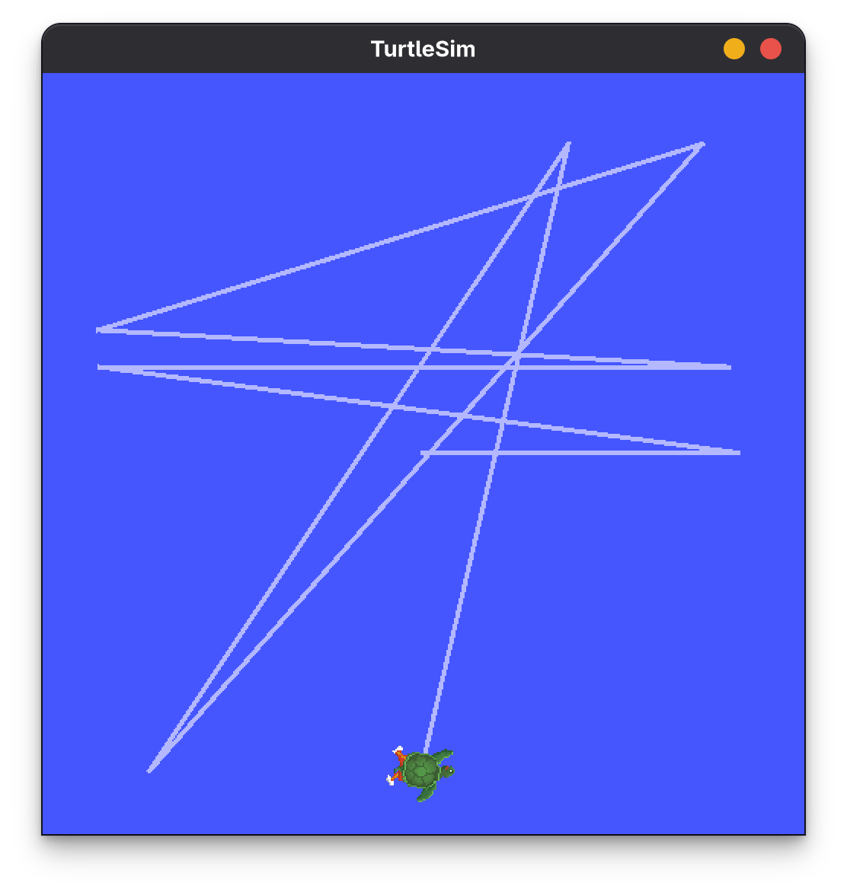
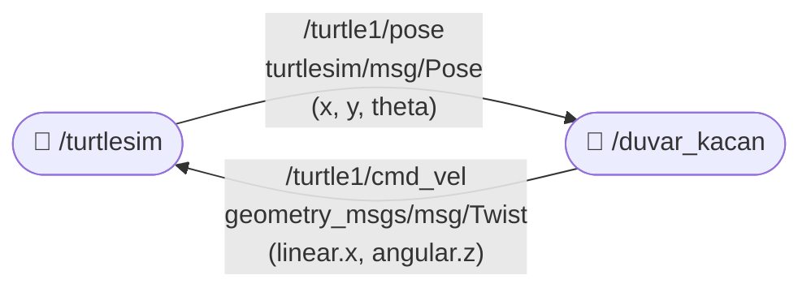
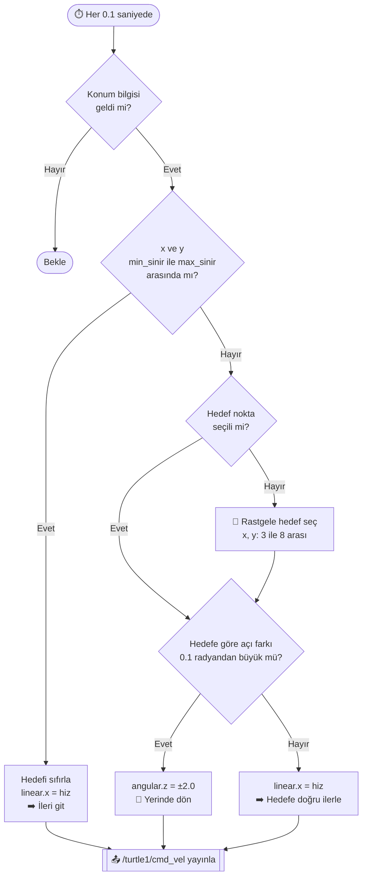
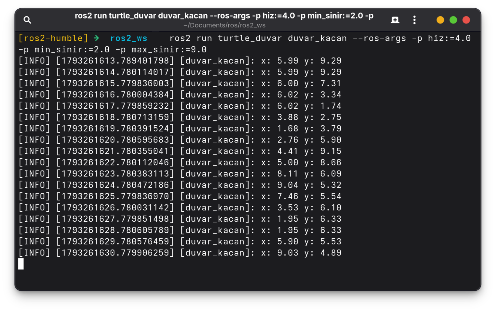
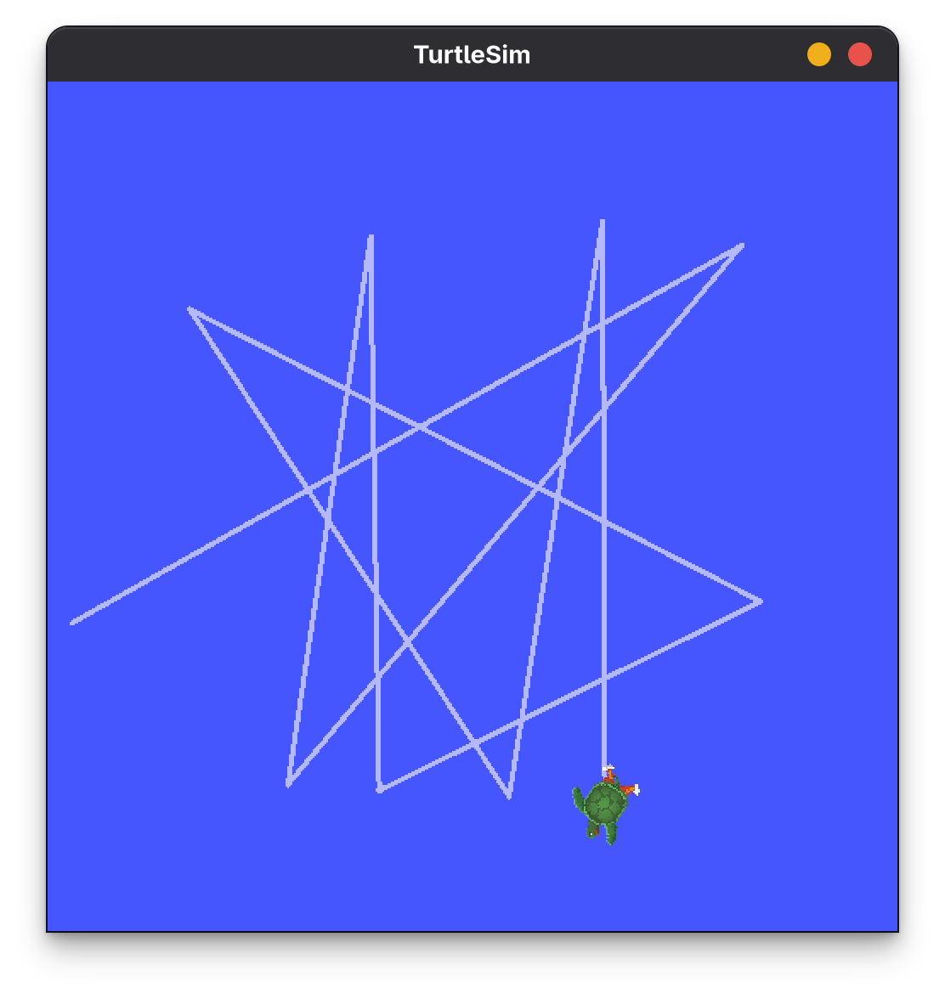
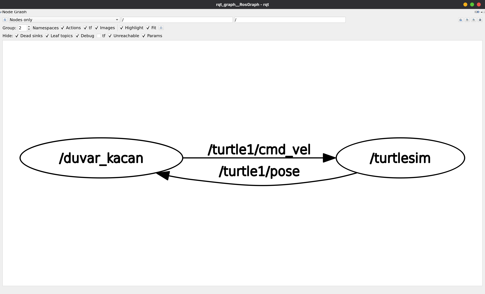

# Duvardan Kaçan Kaplumbağa (ROS 2 / Python)

> 📚 **Ödev Notu:** Bu proje, Robotiğe Giriş dersi kapsamında verilen **"Duvardan Kaçan Kaplumbağa"** ödevi için eğitim amaçlı hazırlanmıştır. Simülasyon ortamı olarak `turtlesim` kullanılır.

`turtlesim` kaplumbağasını duvara çarpmadan sürekli dolaştıran tek düğümlü bir ROS 2 Humble paketi:

- **duvar_kacan** düğümü
  - **Abone:** `/turtle1/pose` konusunu (`turtlesim/msg/Pose`) dinleyerek kaplumbağanın `x` ve `y` değerlerini alır.
  - **Yayıncı:** `/turtle1/cmd_vel` konusuna (`geometry_msgs/msg/Twist`) hız komutu yayınlayarak kaplumbağayı ileri sürer. `x` veya `y` değeri **1.0'dan küçük** ya da **10.0'dan büyük** olursa kaplumbağa dönerek yön değiştirir.
  - **Log:** Kaplumbağanın konumu **saniyede bir** `get_logger().info()` ile yazdırılır.

**Bonus:** Hız ve sınır değerleri `declare_parameter` ile tanımlanmış parametrelerdir: `hiz` (varsayılan: 2.0), `min_sinir` (varsayılan: 1.0), `max_sinir` (varsayılan: 10.0).

## İçindekiler

- [Gereksinimler](#gereksinimler)
- [Derleme](#derleme)
- [Çalıştırma](#çalıştırma)
- [Nasıl Çalışır?](#nasıl-çalışır)
- [Bonus: Hız ve Sınır Parametreleri](#bonus-hız-ve-sınır-parametreleri)
- [Konuları Dinleme](#konuları-dinleme)
- [rqt_graph](#rqt_graph)
- [Paket Yapısı](#paket-yapısı)

## Gereksinimler

- ROS 2 Humble çalıştıran bir ortam
- ROS 2 Humble
- `turtlesim` paketi
- Python paketleri: `rclpy`, `geometry_msgs` (ROS 2 ile birlikte gelir)

`turtlesim` kurulu değilse:

```bash
sudo apt install ros-humble-turtlesim
```

## Derleme

**bash terminal**
```bash
mkdir -p ~/ros2_ws/src
cd ~/ros2_ws/src
git clone https://github.com/ramazanerentepe/turtle_duvar_kacan.git
cd ~/ros2_ws
source /opt/ros/humble/setup.bash
colcon build --packages-select turtle_duvar
```
---

**zsh terminal**
```zsh
mkdir -p ~/ros2_ws/src
cd ~/ros2_ws/src
git clone https://github.com/ramazanerentepe/turtle_duvar_kacan.git
cd ~/ros2_ws
source /opt/ros/humble/setup.zsh
colcon build --packages-select turtle_duvar
```

Bu komutlar bir çalışma alanı (`ros2_ws`) oluşturur, depoyu `src` klasörüne indirir ve derler. Depo adı `turtle_duvar_kacan`, paket adı ise `turtle_duvar`'dır; `colcon` paketi `package.xml` içindeki ada göre tanır, bu yüzden derleme ve çalıştırma komutlarında `turtle_duvar` kullanılır.

`colcon build` mutlaka `src` içinde değil, **`ros2_ws` klasöründe** çalıştırılmalıdır; aksi halde `build`, `install` ve `log` klasörleri yanlış yerde oluşur. Derleme sonunda `Summary: 1 package finished` satırı görünüyorsa paket hatasız derlenmiştir.

## Çalıştırma

Simülatör ve düğüm, iki ayrı terminalde çalıştırılır. Her yeni terminalde önce ROS 2 ortamı ve çalışma alanı yüklenmelidir (`source` satırları).

### Terminal 1: turtlesim

**bash terminal**
```bash
source /opt/ros/humble/setup.bash
ros2 run turtlesim turtlesim_node
```
---

**zsh terminal**
```zsh
source /opt/ros/humble/setup.zsh
ros2 run turtlesim turtlesim_node
```

> 💡 TurtleSim penceresi küçük görünüyorsa komutun başına `QT_SCALE_FACTOR=2` eklenerek iki kat büyük açılabilir: `QT_SCALE_FACTOR=2 ros2 run turtlesim turtlesim_node`



*Şekil 1: `turtlesim_node` başlatıldığında açılan pencere. Terminaldeki `Spawning turtle [turtle1] at x=[5,544445], y=[5,544445], theta=[0,000000]` satırı, kaplumbağanın pencerenin ortasında (x = y ≈ 5.54) ve sağa bakacak şekilde oluşturulduğunu gösterir. `libGL error` ve `WARNING` satırları ekran kartı sürücüsüyle ilgili zararsız uyarılardır; simülasyonu etkilemez.*

### Terminal 2: Duvar Kaçan Düğüm

**bash terminal**
```bash
source /opt/ros/humble/setup.bash
source ~/ros2_ws/install/setup.bash
ros2 run turtle_duvar duvar_kacan
```
---

**zsh terminal**
```zsh
source /opt/ros/humble/setup.zsh
source ~/ros2_ws/install/setup.zsh
ros2 run turtle_duvar duvar_kacan
```

Kaplumbağa ileri doğru hareket etmeye başlar, sınıra geldiğinde dönüp yeni bir yöne gider. Bu sırada terminalde saniyede bir kaplumbağanın konumu yazdırılır.



*Şekil 2: `duvar_kacan` düğümünün çıktısı. Kaplumbağa sağa doğru ilerlerken `x` değeri 7.37 → 9.35 → 10.15 olarak artar; her satır arasında ~2 birim fark olması varsayılan hızın (`hiz: 2.0`) saniyede 2 birim olduğunu doğrular. `x` değeri 10.15 ile üst sınırı (10.0) geçince kaplumbağa döner ve sonraki satırlarda `x` 9.96 → 7.96 olarak azalmaya başlar. Satır başındaki zaman damgaları arasında 1 saniye fark vardır.*



*Şekil 3: Varsayılan parametrelerle bir süre çalıştıktan sonra TurtleSim penceresi. Kaplumbağanın bıraktığı iz, pencere kenarlarına yaklaştığı her noktada keskin bir dönüş yaptığını ve duvara hiç çarpmadığını gösterir. Her dönüşte farklı bir hedef seçildiği için iz hep aynı çizgide gidip gelmez.*

Düğümleri durdurmak için her iki terminalde **Ctrl+C** kullanılır.

## Nasıl Çalışır?

### Düğümler ve Konular



`/turtlesim` kaplumbağanın konumunu yayınlar, `/duvar_kacan` bu konumu okuyup karar verir ve hız komutunu geri gönderir. Böylece kapalı bir kontrol döngüsü oluşur.

### Zamanlayıcılar

Düğümde iki zamanlayıcı (timer) vardır:

| Zamanlayıcı | Periyot | Görev |
|---|---|---|
| `kontrol` | 0.1 s (10 Hz) | Konumu kontrol eder ve `/turtle1/cmd_vel` konusuna hız komutu yayınlar |
| `log` | 1.0 s | Konumu `get_logger().info()` ile yazdırır |

### Karar Mantığı



`kontrol` fonksiyonunun mantığı:

1. Kaplumbağa sınırlar içindeyse (`min_sinir ≤ x ≤ max_sinir` **ve** `min_sinir ≤ y ≤ max_sinir`) `linear.x = hiz` ile **ileri** gider.
2. `x` veya `y` sınırın dışına çıkarsa pencerenin ortasına yakın **rastgele bir hedef nokta** (3–8 arası) seçilir.
3. Kaplumbağa hedefe bakana kadar `angular.z` ile **yerinde döner**, hedefe yöneldiğinde tekrar ileri gider ve sınırların içine geri girer.

Hedefin rastgele seçilmesi sayesinde kaplumbağa her seferinde farklı bir yöne döner ve hep aynı çizgi üzerinde gidip gelmez.

## Bonus: Hız ve Sınır Parametreleri

Hız ve sınır değerleri koda gömülü değildir; `declare_parameter` ile tanımlanmış parametrelerdir. Bu sayede kodu değiştirmeden ayarlanabilir.

| Parametre | Varsayılan | Açıklama |
|---|---|---|
| `hiz` | 2.0 | İleri hareket hızı (`linear.x`) |
| `min_sinir` | 1.0 | `x` ve `y` için alt sınır |
| `max_sinir` | 10.0 | `x` ve `y` için üst sınır |

> ⚠️ Parametreler ondalıklı (`double`) olarak tanımlandığı için değerler `4.0` gibi **noktalı** yazılmalıdır; `4` yazılırsa tip hatası alınır.

**Başlatırken parametreleri belirlemek için:**

**bash terminal**
```bash
ros2 run turtle_duvar duvar_kacan --ros-args -p hiz:=4.0 -p min_sinir:=2.0 -p max_sinir:=9.0
```
---

**zsh terminal**
```zsh
ros2 run turtle_duvar duvar_kacan --ros-args -p hiz:=4.0 -p min_sinir:=2.0 -p max_sinir:=9.0
```



*Şekil 4: Düğümün `hiz:=4.0`, `min_sinir:=2.0`, `max_sinir:=9.0` ile çalıştırılması. Kaplumbağa artık saniyede yaklaşık 4 birim ilerler (örneğin `y` 7.31 → 3.34). `y` 9.29 ile üst sınırı, `y` 1.74 ve `x` 1.68 ile alt sınırı geçtiği anlarda döner. Art arda aynı kalan satırlar (`x: 5.99 y: 9.29` ve `x: 1.95 y: 6.33`), kaplumbağanın o saniye boyunca yerinde dönerek yön değiştirdiğini gösterir. Tüm değerler 2–9 aralığının hemen çevresinde kalır.*

<table>
  <tr>
    <th>Varsayılan<br><code>hiz: 2.0</code> · sınır: 1.0 – 10.0</th>
    <th>Parametreli<br><code>hiz: 4.0</code> · sınır: 2.0 – 9.0</th>
  </tr>
  <tr>
    <td></td>
    <td></td>
  </tr>
</table>

*Şekil 5: Varsayılan ve parametreli çalıştırmanın karşılaştırması. Solda kaplumbağa pencere kenarlarına kadar gidip dönerken, sağda sınırlar 2–9'a daraltıldığı için daha küçük bir alanda dolaşır ve kenarlara yaklaşmadan döner.*

**Düğüm çalışırken parametreleri değiştirmek için** (üçüncü bir terminalde):

**bash terminal**
```bash
ros2 param list /duvar_kacan
ros2 param get /duvar_kacan hiz
ros2 param set /duvar_kacan hiz 5.0
```
---

**zsh terminal**
```zsh
ros2 param list /duvar_kacan
ros2 param get /duvar_kacan hiz
ros2 param set /duvar_kacan hiz 5.0
```

`param get` güncel değeri gösterir, `param set` komutu ise `Set parameter successful` yanıtı verir. Düğüm her kontrol adımında parametreleri yeniden okuduğu için yeni değer, düğümü yeniden başlatmadan hemen devreye girer.

## Konuları Dinleme

Kaplumbağanın konum mesajlarını doğrudan görmek için:

**bash terminal**
```bash
ros2 topic echo /turtle1/pose
```
---

**zsh terminal**
```zsh
ros2 topic echo /turtle1/pose
```

Düğümün yayınladığı hız komutlarını görmek için:

**bash terminal**
```bash
ros2 topic echo /turtle1/cmd_vel
```
---

**zsh terminal**
```zsh
ros2 topic echo /turtle1/cmd_vel
```

`Pose` mesajında `x`, `y`, `theta`, `linear_velocity` ve `angular_velocity` alanları bulunur. `Twist` mesajında kaplumbağa ileri giderken `linear.x`, dönerken `angular.z` değeri dolu olur.

## rqt_graph

Simülatör ve düğüm çalışırken yeni bir terminalde:

**bash terminal**
```bash
rqt_graph
```
---
**zsh terminal**
```zsh
rqt_graph
```



*Şekil 6: Çalışan düğümlerin grafiği. `/duvar_kacan` düğümü `/turtle1/cmd_vel` konusuna yayın yapar ve `/turtlesim` bu komutlarla kaplumbağayı hareket ettirir. `/turtlesim` ise kaplumbağanın konumunu `/turtle1/pose` konusuna yayınlar ve `/duvar_kacan` bu konuya abonedir. İki ok birlikte kapalı bir kontrol döngüsü oluşturur: konum okunur, karar verilir, hız komutu gönderilir.*

## Paket Yapısı

```text
turtle_duvar_kacan/
├── README.md                  # Bu dosya: kurulum ve çalıştırma
├── images/                    # Ekran görüntüleri
│   ├── turtlesim_acilis.png
│   ├── duvar_kacan.png
│   ├── turtlesim.png
│   ├── parametre_terminal.png
│   ├── parametre_turtlesim.png
│   └── rqt_graph.png
├── package.xml                # Paket bilgisi ve bağımlılıklar (rclpy, geometry_msgs, turtlesim)
├── setup.py                   # Python kurulumu ve entry_points
├── setup.cfg
├── LICENSE
├── resource/
├── test/
└── turtle_duvar/
    ├── __init__.py
    └── duvar_kacan.py         # Abone + yayıncı düğüm
```

---

*Bu depo ödev amaçlı hazırlanmıştır.*
